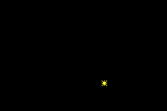

# orbits
An exercise for learning about header files in C++. See instructions [here](./instructions.md)

## controls
- **A** - Add an orbitter
- **B** - Remove last created orbitter if there is any
- **START** - Remove all orbitters

---
